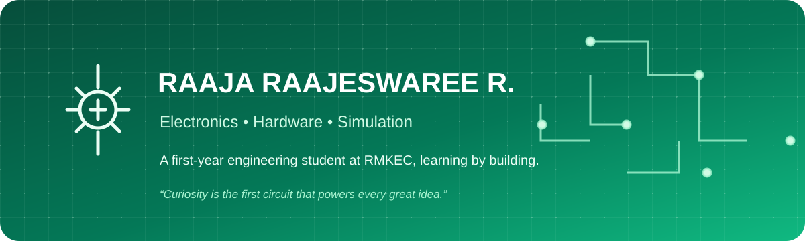

  

<h1 align="center">⚡ My First One</h1>
<h3 align="center">Curious today. Creating tomorrow. 💚</h3>

  
  
  

> **“Curiosity is the first circuit that powers every great idea.”**

## 👋 Hello, I'm Raaja Raajeswaree R.

I am a **first-year student at R.M.K. Engineering College (RMKEC)**, excited to explore the world of **electronics, hardware, and simulation**. I love wondering how things work—and I am eager to learn the ideas and engineering behind the technology all around us.

**My First One** is the beginning of that journey: a place to share what I learn, explore new concepts, and grow from curiosity into hands-on creation. I am just getting started, and I look forward to discovering what I can build.

## 🔌 What I’m Curious About

- Electronics and the fundamentals of circuits
- Hardware components and how they work together
- Circuit and hardware simulation
- Embedded systems and microcontrollers
- Connecting software with real-world hardware
- Engineering ideas that can make everyday life better

## 🌱 What I’m Learning and Exploring

As I build my foundation, I hope to:

- Strengthen my understanding of electronics and engineering
- Explore simulation tools and learn through experimentation
- Develop problem-solving and practical project skills
- Document my progress and share what I discover
- Build a portfolio of projects as my skills grow

## 🚀 The Journey Ahead

This repository is my starting point—not the finish line. As I learn, I plan to add experiments, project ideas, useful notes, and practical work. Each new concept is an opportunity to ask questions, try something out, and improve.

> **“You don’t have to know it all to begin. You just have to be curious enough to take the first step.”**

## 🤝 Let’s Connect

I’m happy to connect with fellow students, makers, and anyone who enjoys learning about technology and engineering.

- **GitHub:** [@26ee026-lgtm](https://github.com/26ee026-lgtm)
- **College:** R.M.K. Engineering College (RMKEC)
- **LinkedIn:** Add your LinkedIn profile URL here when ready

### 📌 Add this project to LinkedIn Featured

Open your LinkedIn profile, choose **Add profile section → Recommended → Add featured**, then add a link to this project:

**[My First One — GitHub Project](https://github.com/26ee026-lgtm/My-First-One-)**

You can also download the README using [this direct link](https://raw.githubusercontent.com/26ee026-lgtm/My-First-One-/main/README.md), or download the repository files from GitHub using **Code → Download ZIP**. To upload a polished document as Featured media, copy this profile into a document and export it as a PDF, then upload that PDF from LinkedIn’s Featured section.

---

<b>💚 Learning with curiosity. Building with purpose. Growing one idea at a time. 💚</b>

